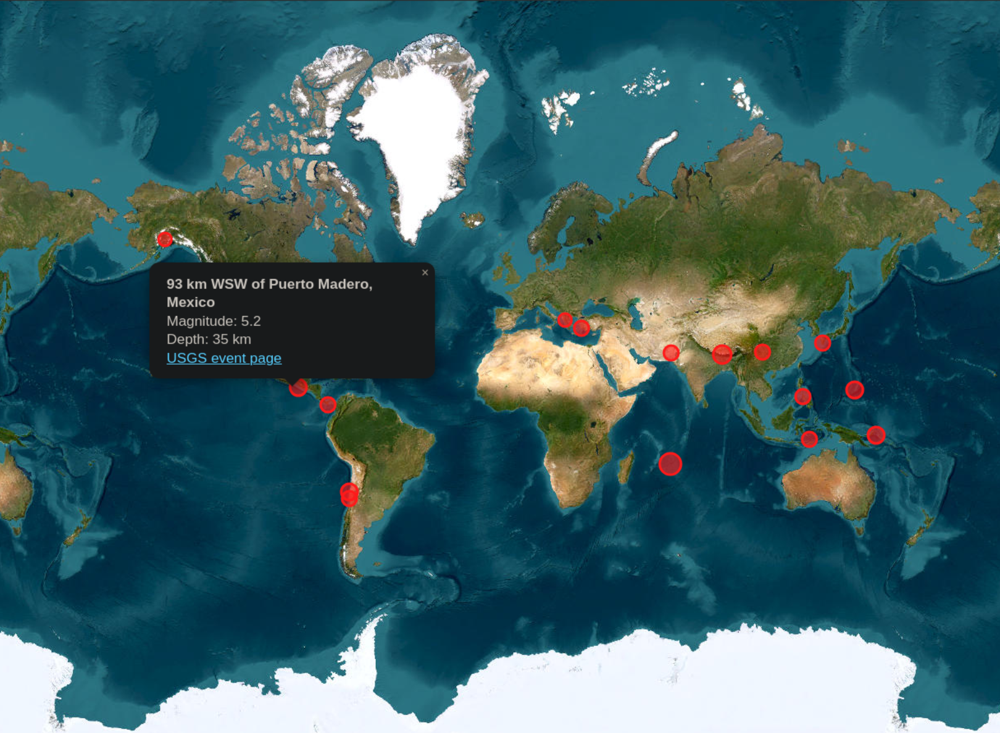

# Earthquake Map

A daily map of earthquakes reported by the [USGS](https://earthquake.usgs.gov/) in the last 24 hours, built with Python and Folium.

**Live map:** https://desk4444.github.io/earthquakes_viewer/



## Features

- Fetches earthquake data from the USGS Earthquake Hazards API
- Saves each day's raw data as a GeoJSON file in `data/`
- Builds an interactive map with one marker per earthquake, sized by magnitude
- Popups show the place, magnitude, depth, and a link to the USGS event page
- Keeps an archive of daily maps with an index page to browse them
- Updates automatically every day with GitHub Actions

## Project structure

```
earthquake-map/
├── .github/workflows/update.yml   # daily automation
├── data/                          # one GeoJSON file per day
├── docs/                          # generated maps, served by GitHub Pages
├── earthquake_map/
│   ├── config.py                  # settings: URL, magnitude filter, folders
│   ├── fetch.py                   # downloads and saves the USGS data
│   └── map_builder.py             # builds the Folium maps and index page
├── main.py                        # entry point
└── requirements.txt
```

## Installation

Requires Python 3.10 or newer.

```bash
git clone https://github.com/desk4444/earthquakes_viewer
cd earthquakes_viewer
pip install -r requirements.txt
```

## Usage

Run from the project root:

```bash
python main.py
```

This fetches yesterday's earthquakes, saves them to `data/`, and writes the map to `docs/`. Open `docs/index.html` in your browser to see the archive.

## Settings

Edit `earthquake_map/config.py` to change the USGS URL, the minimum magnitude, or the output folders.

## Data

Earthquake data comes from the USGS Earthquake Hazards Program. Each file in `data/` is a snapshot taken on the day it was fetched. USGS updates some fields (such as review status and felt reports) after an earthquake, so the same event may differ slightly between days.

## License

MIT. See [LICENSE](LICENSE).
